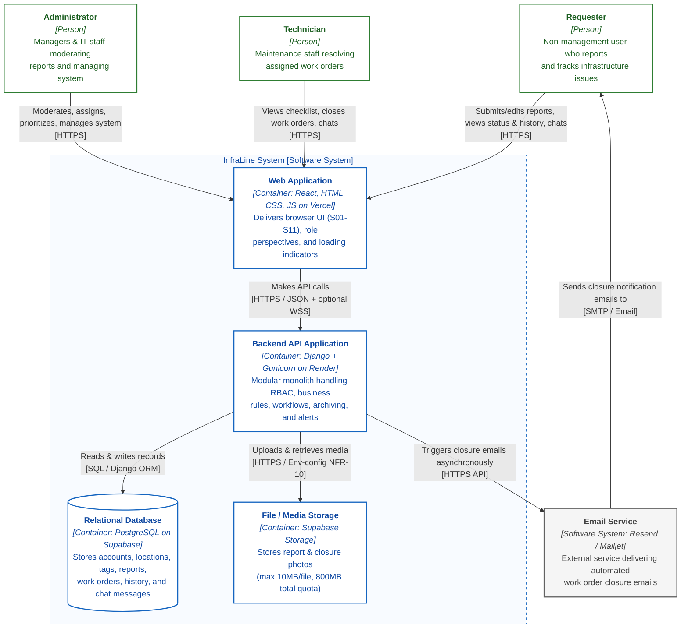
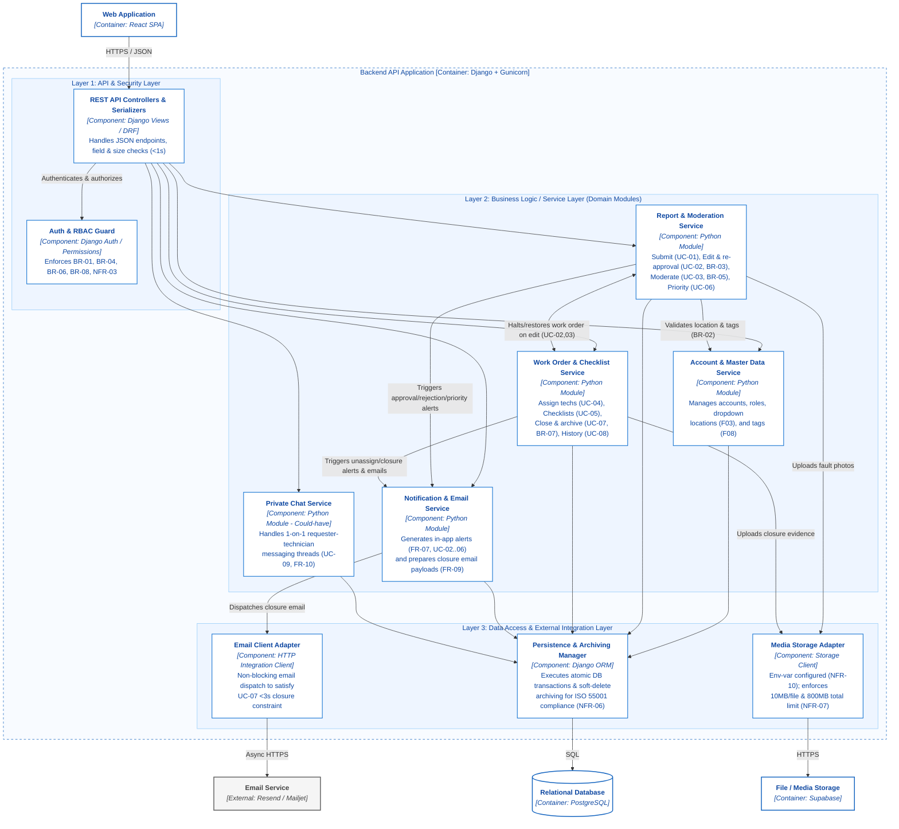
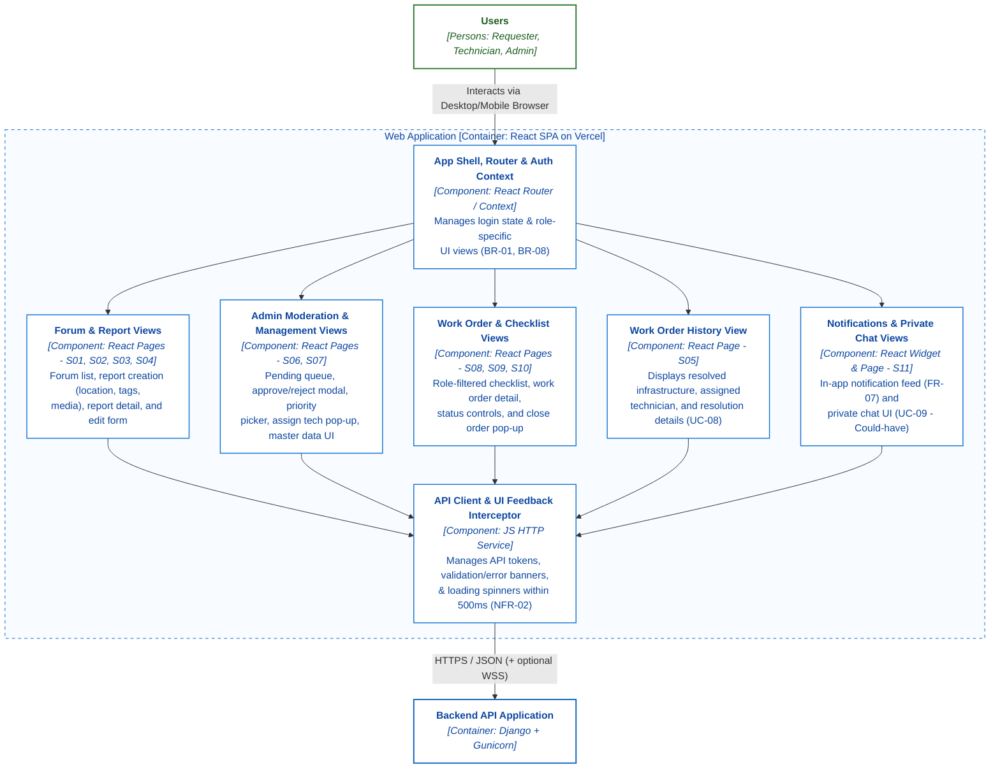

# Prompt 1

Based on these documents, suggest the architectural style(s) that can be used (layered, MVC, client–server, microservices, event-driven,…) for the software.

# Answer 1

Based on the requirements, technology stack, deployment environment, and project constraints described in both documents (the Vision/Project Plan and the SRS), **InfraLine** is best suited for a **hybrid architecture** that combines a **Client–Server (3-Tier Web)** topology with a **Layered Modular Monolith** on the backend, using **MVC/MVT** internally and **lightweight Event-Driven** mechanisms for notifications and optional chat.

Below is a detailed breakdown of the architectural styles that fit InfraLine, how they map to the documents, and which styles should be avoided.

---

### 1. Recommended Primary Architectural Styles

#### A. Client–Server Architecture (3-Tier Distributed Web Architecture)
* **Why it fits:** The SRS explicitly constrains InfraLine to be a web-based application accessed via browsers rather than a desktop application (SRS, Section 3), while the Project Plan specifies separate hosting tiers (Vision, Sections 3.2–3.3):
  * **Client / Presentation Tier:** **React** (HTML/CSS/JS) hosted on **Vercel**, serving different role-based UI perspectives (Requester, Administrator, Technician across screens S01–S11) on desktop and mobile browsers (NFR-04, NFR-09).
  * **Application / Server Tier:** **Django + Gunicorn** hosted on **Render**, handling authentication, business rules, and API requests.
  * **Data / Storage Tier:** **PostgreSQL and File Storage** hosted on **Supabase** (storing structured records and up to 800 MB of attachments per NFR-07).
* **Key Design Note from the Docs:** Section 3.2 of the Vision document mentions both **React** on Vercel and *"page rendering through templates"* for Django, while WBS 2.1.3 notes *"Design API routes (If necessary)"* and NFR-03/NFR-06 reference **API access**. Because the frontend and backend are deployed separately on Vercel and Render, adopting a **Client–Server REST API style** (e.g., React SPA communicating with Django REST endpoints over HTTPS/JSON) resolves this inconsistency cleanly.

#### B. Layered Architecture (within a Modular Monolith)
* **Why it fits:** Within the Django backend, a **Layered (N-Tier) Architecture** cleanly separates concerns, improves maintainability for GitHub PR reviews (NFR-08), and provides a single place to enforce security and compliance across both UI and API calls (NFR-03, NFR-06).
* **Suggested Layers:**
  1. **Presentation / API Layer:** React components on the client + Django URL routing, request parsing, and input validation (e.g., checking character limits and attachment size limits in UC-01, UC-02, UC-03, UC-04, UC-07 within `< 1 second`).
  2. **Business Logic / Service Layer:** Enforces role-based permissions and all **Business Rules (BR-01 to BR-08)**—such as mandatory location selection (BR-02), requiring re-approval when a report is edited (BR-03), restricting approval/assignment/priority setting to Administrators (BR-04), enforcing rejection/closure reasons (BR-05, BR-07), and coordinating multi-step transactions (e.g., archiving both a report and its work order during an edit in UC-02).
  3. **Data Access / Persistence Layer:** Django ORM managing PostgreSQL tables and enforcing soft-delete/archiving rules so delete attempts retain maintenance history in compliance with **ISO 55001** (NFR-06), alongside environment-variable-based file storage configuration for Supabase (NFR-10).
  4. **Integration / Infrastructure Layer:** Adapters for external services shown in the System Context Diagram (Vision, Section 3.1), specifically **Resend or Mailjet** for email delivery (Vision, Section 3.3; UC-07).

#### C. MVC / MVT (Model–View–Controller / Model–View–Template)
* **Why it fits:** **Django** natively implements the **MVT** pattern (a variation of MVC), which is explicitly leveraged in Vision Section 3.2 (*"Easy URLs setup... built-in authentication with setup"*).
  * **Models:** Represent core domain entities (Users/Roles, Reports, Work Orders, Locations, Tags, History Archives, Chat Messages).
  * **Views / Controllers:** Handle request flows, RBAC checks, and orchestration for use cases UC-01 through UC-09.
  * **Presentation (React Views / Templates):** Renders screens S01–S11 cleanly based on serialized JSON data from the backend.
* **Benefit for the Timeline:** Because the project follows a **Waterfall model** with only ~2–3 weeks allocated to implementation, testing, and deployment before PA5 (Week 8 to Week 10), using Django’s built-in MVC/MVT conventions accelerates CRUD development for the "Must-have" features.

---

### 2. Recommended Secondary / Hybrid Style

#### D. Lightweight Event-Driven Mechanisms (Targeted Use Only)
While a full distributed event-driven architecture is unnecessary, **event-driven / asynchronous hooks** solve three specific behaviors in the SRS:
1. **External Email Dispatch (FR-09 / UC-07):** Closing a work order triggers an email via Resend or Mailjet (Step 9), while UC-07 requires Steps 7–9 to complete in **under 3 seconds**. Triggering email sending asynchronously (e.g., via a background task/webhook rather than blocking the HTTP response) prevents external email API latency from breaking this NFR.
2. **In-App Notifications:** Several use cases trigger notifications upon state transitions—report approved/rejected (FR-07, UC-03), work order halted or restored after a report edit (UC-02, UC-03), technician unassigned (UC-04), and priority updated (UC-06). Using internal domain events (or Django signals/service hooks) keeps notification logic decoupled from core workflow handlers.
3. **Private Chat (FR-10 / UC-09 / S11):** Because this is a **"Could-have"** feature, if implemented, it can use lightweight **WebSockets** (e.g., Django Channels) or **Supabase Realtime** (event subscriptions) rather than complex external message brokers.

---

### 3. Architectural Styles NOT Recommended

#### Microservices Architecture
* **Massive Over-Engineering for Target Scale:** NFR-01, NFR-03, NFR-05, and NFR-06 specify a scale of **≤ 10 concurrent users**, **≤ 30 total accounts**, and **≤ 40 recorded posts**. Microservices introduce network latency, service discovery, and operational overhead without any scaling benefit at this load.
* **Waterfall Schedule & Hosting Limits:** With an 11-week schedule (PA3 Design in Week 7, PA5 Demo in Week 10) and free-tier hosting constraints (Render free tier and Supabase's limit of 2 active projects), splitting the backend into multiple services creates unnecessary deployment friction.
* **Tightly Coupled Transactions:** Reports and Work Orders require atomic consistency across operations—for example, editing an approved report immediately archives both the forum post and the associated work order (UC-02), and rejecting the edit restores both (UC-03). A **monolithic database transaction** handles this far more reliably than distributed transactions across microservices.

#### Full Distributed Event-Driven Architecture (e.g., Kafka / RabbitMQ Mesh)
* Requiring separate message-broker infrastructure adds operational cost and complexity beyond the free-tier stack (Vercel, Render, Supabase) and is unwarranted given the `<= 10` concurrent user requirement.

---

### Summary Table

| Architectural Style | Recommendation | Role in InfraLine | Evidence from Documents |
| :--- | :--- | :--- | :--- |
| **Client–Server (3-Tier)** | **Use (Primary System Topology)** | Separates React browser client (Vercel), Django API server (Render), and PostgreSQL/Storage (Supabase). | Vision Sec. 3.2–3.3; SRS Sec. 3, NFR-03, NFR-06 |
| **Layered (Modular Monolith)** | **Use (Primary Backend Structure)** | Isolates API, business rules (RBAC, workflows), ORM/archiving, and external email adapters. | SRS Sec. 5.3 (BR-01–BR-08), NFR-06, NFR-08, NFR-10 |
| **MVC / MVT** | **Use (Framework Pattern)** | Structures Django backend models/controllers and React UI views for rapid delivery. | Vision Sec. 3.2, Sec. 4.1–4.2 (11-week Waterfall) |
| **Event-Driven (Lightweight)** | **Use Selectively (Hybrid)** | Handles async email sending, in-app state notifications, and optional live chat. | FR-07, FR-09, FR-10; UC-02–UC-04, UC-06, UC-07, UC-09 |
| **Microservices** | **Avoid** | Unsuitable for small scale, tight ACID coupling, free-tier hosting, and short timeline. | NFR-01/03/05/06 (10 users, 30 accounts); Vision Sec. 3.3, 4.1 |


# Prompt 2

Is the Layered Modular Monolith the Server Tier in the Client-Server architecture? How do they fit with each other?

# Answer 2

**Yes.** More precisely, the **Layered Modular Monolith is the internal design and deployment structure of the Server Tier** inside the Client–Server architecture.

A helpful way to keep them straight is to think of them as answering three different architectural questions about **InfraLine**:
1. **Client–Server (3-Tier):** *Where do the pieces run physically, and how do they talk over the network?*
2. **Modular Monolith:** *Is the Server Tier deployed as one application or many separate microservices?*
3. **Layered Architecture:** *How is the code organized inside that Server Tier?*

---

### How They Fit Together Visually

```text
+-------------------------------------------------------------------+
| 1. CLIENT TIER (Browser - React SPA hosted on Vercel)             |
|    Screens S01–S11 (Requester, Technician, Admin perspectives)    |
+---------------------------------+---------------------------------+
                                  |  HTTPS / JSON (REST API)
                                  v
+-------------------------------------------------------------------+
| 2. SERVER TIER (Render + Gunicorn + Django)                       |
|    ==> Implemented as a LAYERED MODULAR MONOLITH <==              |
|                                                                   |
|  [Layer 1: API / Presentation Layer]                              |
|    URL routing, Auth/RBAC checks (BR-01, BR-04), input validation |
|                                                                   |
|  [Layer 2: Business Logic / Service Layer]                        |
|    +-----------+ +-----------+ +-------------+ +---------------+  |
|    |  Accounts | |  Reports  | | Work Orders | | Notifications |  |
|    |  Module   | |  Module   | |   Module    | | & Chat Module |  |
|    +-----------+ +-----------+ +-------------+ +---------------+  |
|    Enforces BR-02..BR-07, coordinates multi-module workflows      |
|                                                                   |
|  [Layer 3: Data Access & Integration Layer]                       |
|    Django ORM (ISO 55001 archiving per NFR-06), Storage adapter,  |
|    Email adapter (Resend / Mailjet)                               |
+---------------------------------+----------------+----------------+
                                  | SQL / Storage  | HTTPS API
                                  v                v
+-----------------------------------+   +---------------------------+
| 3. DATA TIER (Supabase)           |   | EXTERNAL SYSTEM           |
| - PostgreSQL Database             |   | Email Service             |
| - File Storage (attachments)      |   | (Resend or Mailjet)       |
+-----------------------------------+   +---------------------------+
```

---

### Breaking Down the Relationship

#### 1. Tiers (Client–Server) = Physical & Network Boundaries
In **Client–Server (3-Tier)** architecture, "tiers" refer to separate runtime/hosting environments communicating over a network (Vision, Sections 3.2–3.3):
* **Client Tier:** React running in the user's browser (served from **Vercel**). It handles UI rendering and sends HTTP requests.
* **Server Tier:** Django running with Gunicorn on **Render**. It acts as the central gatekeeper and brain of the application.
* **Data Tier:** Managed PostgreSQL and File Storage on **Supabase**.

#### 2. Modular Monolith = How the Server Tier Is Packaged
Instead of splitting the Server Tier into separate servers for Reports, Work Orders, Users, and Notifications (Microservices), all backend functionality runs as **one single Django process/deployment** on Render—that is the **Monolith** part.

Inside that single application, you still separate the code cleanly by business domain into **Modules** (e.g., separate Django apps for `accounts`, `reports`, `work_orders`, `notifications`, and `chat`)—that is the **Modular** part. Because `Reports` and `Work Orders` are tightly linked (e.g., editing a report in **UC-02** immediately archives its associated work order), having them in the same monolith allows them to share one database transaction safely.

#### 3. Layered Architecture = How Code Is Organized Inside the Monolith
While **Modules** divide the Server Tier *vertically* by feature/domain, **Layers** divide it *horizontally* by technical responsibility:
* **API / Controller Layer (top):** Receives HTTP requests from React, checks user identity/roles (NFR-03), and validates payload rules (e.g., character limits, file sizes). It does **not** touch SQL directly.
* **Business Logic / Service Layer (middle):** Contains the core rules of InfraLine (BR-01 to BR-08) and coordinates actions across modules.
* **Data Access & Integration Layer (bottom):** Talks to Supabase PostgreSQL via Django ORM, uploads images to Supabase Storage (configurable via environment variables per NFR-10), and calls external services like Resend/Mailjet.

*(Note: At the **whole-system** level, you can also view the React frontend on Vercel as the outermost Presentation Layer and Supabase on the bottom as the physical Persistence Layer—but internally, the Django Server Tier still needs its own API, Business, and Data Access layers.)*

---

### Concrete Example: Tracing **UC-07 (Close Work Order)** Through the Whole Architecture

To see how all pieces interact in practice, here is what happens when a technician closes a work order:

1. **Client Tier (React on Vercel):** On screen **S10**, the technician fills in the closure reason, selects "Yes" for resolved, attaches an evidence photo, and clicks *"Close Order"*. React sends a `POST`/`PATCH` request over HTTPS to the Render server.
2. **Server Tier — API Layer (Django on Render):** Authenticates the request token, verifies the payload (e.g., reason is not empty per **BR-07**, attachment is ≤ 10 MB per **NFR-07**), and routes it to the service layer.
3. **Server Tier — Business Logic Layer (across Modules):**
   * *Work Orders Module:* Confirms the logged-in technician is actually assigned to this work order (**BR-06**), removes it from checklists, and records it in maintenance history.
   * *Reports Module:* Archives/removes the associated forum post while preserving history intact (**NFR-06**, ISO 55001 compliance).
   * *Notifications Module:* Queues an automated completion email (**FR-09**).
4. **Server Tier — Data Access & Integration Layer $\rightarrow$ Data Tier & External Systems:**
   * Uploads the evidence photo to **Supabase Storage** and saves the work order + archived report changes together in **one PostgreSQL transaction** on **Supabase**.
   * Dispatches the email payload to **Resend/Mailjet** asynchronously so the user gets their response within the `< 3 seconds` non-functional requirement (**UC-07**).
5. **Back to Client Tier:** The Server Tier returns a `200 OK` JSON response, and React updates the UI to show the updated checklist/history.

### Summary
* **Client–Server (3-Tier)** defines the **macro-architecture** across Vercel, Render, and Supabase.
* **Layered Modular Monolith** defines the **internal architecture of the Render/Django Server Tier**, keeping your modules cleanly separated by domain (`Reports`, `Work Orders`, etc.) and by technical layer (`API`, `Business Logic`, `Data Access`) inside a single, easy-to-deploy backend.


# Prompt 3

Draw the container diagram and component diagram(s) for the whole system.

# Answer 3

To align with the **C4 System Context diagram** already in your Vision document (Section 3.1), below are the next two C4 levels for **InfraLine**:
1. **Level 2: Container Diagram** (the whole system across Vercel, Render, Supabase, and external email).
2. **Level 3: Component Diagrams** for both custom-built application containers:
   * **Backend API Application** (Django + Gunicorn Modular Monolith)
   * **Web Application** (React SPA)

Each diagram is provided as an immediate visual diagram plus copy-ready **Mermaid** code (using the same color conventions as Section 3.1) so you can easily export high-resolution graphics for **PA3**.

---

## 1. Level 2: Container Diagram (Whole System)

### Visual Overview

```text
+----------------+       +----------------+       +--------------------+
|   Requester    |       |   Technician   |       |   Administrator    |
|    [Person]    |       |    [Person]    |       |      [Person]      |
+-------+--------+       +-------+--------+       +---------+----------+
        |                        |                          |
        | Reports issues,        | Views checklist,         | Moderates posts,
        | views status,          | updates/closes orders,   | assigns techs, sets
        | chats (UC-01,02,08,09) | chats (UC-05,07,08,09)   | priority (UC-03..08)
        +-----------+------------+------------+-------------+
                    |                         |
                    v                         v
+======================================================================+
| InfraLine System [Software System]                                   |
|                                                                      |
|  +----------------------------------------------------------------+  |
|  | Web Application                                                |  |
|  | [Container: React, HTML, CSS, JS - Hosted on Vercel]           |  |
|  | Serves screens S01-S11, role views, loading states (NFR-02).   |  |
|  +-------------------------------+--------------------------------+  |
|                                  |                                   |
|                                  | HTTPS / JSON (REST API)           |
|                                  | (+ optional WSS for UC-09 chat)   |
|                                  v                                   |
|  +----------------------------------------------------------------+  |
|  | Backend API Application                                        |  |
|  | [Container: Python / Django + Gunicorn - Hosted on Render]     |  |
|  | Modular monolith handling auth/RBAC, business rules (BR-01..08)|  |
|  | workflows, ISO 55001 archiving (NFR-06), & alerts/emails.      |  |
|  +---------------+--------------------------------+---------------+  |
|                  |                                |                  |
|      SQL / ORM   |                                | HTTPS / S3 API   |
|                  v                                v                  |
|  +-------------------------------+  +-----------------------------+  |
|  | Relational Database           |  | File / Media Storage        |  |
|  | [Container: PostgreSQL]       |  | [Container: Supabase]       |  |
|  | (Hosted on Supabase)          |  | Equipment & closure photos  |  |
|  | Users, reports, work orders,  |  | (<=10MB/file, <=800MB total |  |
|  | history archives, chat logs.  |  | per NFR-07, env-var NFR-10) |  |
|  +-------------------------------+  +-----------------------------+  |
|                                                                      |
+==================================+===================================+
                                   |
                                   | Async HTTPS API (UC-07, FR-09)
                                   v
                   +-------------------------------+
                   | Email Service                 |
                   | [External: Resend / Mailjet]  |
                   +---------------+---------------+
                                   |
                                   | Sends closure email updates
                                   v
                         ( Back to Requester )
```

### Mermaid Code (Container Diagram)



---

## 2. Level 3: Component Diagram 1 — Backend API Application (`Django Modular Monolith`)

This diagram zooms into the **Backend API Application** (Render), showing how **Layered Architecture** and **Domain Modules** work together inside the monolith.

### Visual Overview

```text
                        [ From Web Application (HTTPS/JSON) ]
                                          |
                                          v
+===============================================================================+
| Backend API Application [Container: Django + Gunicorn on Render]              |
|                                                                               |
|  --- LAYER 1: API & Security Layer -----------------------------------------  |
|  +----------------------------------+   +----------------------------------+  |
|  | REST API Controllers &           |-->| Auth & RBAC Guard                |  |
|  | Serializers (WBS 2.1.3)          |   | (Django Auth + Role Permissions) |  |
|  | Input & limit checks (<1s SLA)   |   | Enforces BR-01, BR-04, BR-06,    |  |
|  +----------------+-----------------+   | BR-08, NFR-03 (anti-injection)   |  |
|                   |                     +----------------------------------+  |
|                   v                                                           |
|  --- LAYER 2: Business Logic / Domain Modules ------------------------------  |
|  +-------------------+  +----------------------+  +------------------------+  |
|  | Account & Master  |  | Report & Moderation  |  | Work Order & Checklist |  |
|  | Data Service      |  | Service              |  | Service                |  |
|  | - Users & roles   |  | - Submit/Edit report |  | - Assign techs (UC-04) |  |
|  | - Locations (F03) |<>| - Approve/Reject     |<>| - Checklist (UC-05)    |  |
|  | - Tags (F08)      |  | - Set priority       |  | - Close order (UC-07)  |  |
|  | (BR-01, BR-02)    |  | (UC-01,02,03,06,BR03)|  | - History (UC-08, BR07)|  |
|  +--------+----------+  +----------+-----------+  +-----------+------------+  |
|           |                        |                          |               |
|           |                        v                          v               |
|           |             +----------------------+  +------------------------+  |
|           |             | Notification & Email |  | Private Chat Service   |  |
|           |             | Service              |  | [Could-have: UC-09]    |  |
|           |             | - In-app alerts      |  | - 1-on-1 chat threads  |  |
|           |             |   (FR-07, UC-02..06) |  |   between requester &  |  |
|           |             | - Email trigger(FR09)|  |   technician (FR-10)   |  |
|           |             +----------+-----------+  +-----------+------------+  |
|           |                        |                          |               |
|           +------------------------+-------------+------------+               |
|                                                  |                            |
|                                                  v                            |
|  --- LAYER 3: Data Access & External Integration Layer ---------------------  |
|  +--------------------------+  +---------------------+  +------------------+  |
|  | Persistence & Archiving  |  | Media Storage       |  | Email Client     |  |
|  | (Django ORM + SoftDelete)|  | Adapter             |  | Adapter          |  |
|  | - ACID transactions      |  | - Upload/quota check|  | - Async HTTP to  |  |
|  | - ISO 55001 (NFR-06)     |  |   <=10MB / <=800MB  |  |   Resend/Mailjet |  |
|  +------------+-------------+  | - Env config (NFR10)|  |   (<3s SLA UC-07)|  |
|               |                +----------+----------+  +--------+---------+  |
+===============|===========================|======================|============+
                v                           v                      v
      [PostgreSQL Database]        [Supabase Storage]       [Email Service]
```

### Mermaid Code (Backend Component Diagram)



---

## 3. Level 3: Component Diagram 2 — Web Application (`React SPA`)

This diagram zooms into the **Web Application** (Vercel), mapping every prototype screen (`S01–S11`) and client-side non-functional requirement (`NFR-02`, `BR-01`) into React components.

### Visual Overview

```text
               [ Requester / Technician / Administrator (Browser) ]
                                        |
                                        v
+==============================================================================+
| Web Application [Container: React SPA on Vercel]                             |
|                                                                              |
|  +------------------------------------------------------------------------+  |
|  | App Shell, Router & Auth Context                                       |  |
|  | Role-aware navigation, session state, & route protection (BR-01, BR-08)|  |
|  +--------+--------------------------+--------------------------+---------+  |
|           |                          |                          |            |
|           v                          v                          v            |
|  +------------------+   +-------------------------+   +-------------------+  |
|  | Forum & Report   |   | Admin Moderation &      |   | Work Order &      |  |
|  | Views            |   | Management Views        |   | Checklist Views   |  |
|  | (S01, S02,       |   | (S06, S07, System Admin)|   | (S08, S09, S10)   |  |
|  |  S03, S04)       |   | - Approve/reject (UC-03)|   | - Checklist(UC-05)|  |
|  | - Forum feed     |   | - Assign techs (UC-04)  |   | - Order detail    |  |
|  | - Submit (UC-01) |   | - Priority (UC-06)      |   | - Close modal     |  |
|  | - Edit (UC-02)   |   | - Accounts/locations    |   |   (UC-07, BR-07)  |  |
|  +--------+---------+   +------------+------------+   +---------+---------+  |
|           |                          |                          |            |
|           |             +------------v------------+   +---------v---------+  |
|           |             | History View            |   | Alerts & Private  |  |
|           |             | (S05)                   |   | Chat Views        |  |
|           |             | - Fixed items, fixer,   |   | (S11 + Bell Feed) |  |
|           |             |   timestamp (UC-08, F04)|   | - Chat (UC-09)    |  |
|           |             +------------+------------+   +---------+---------+  |
|           |                          |                          |            |
|           +--------------------------+--------------------------+            |
|                                      |                                       |
|                                      v                                       |
|  +------------------------------------------------------------------------+  |
|  | API Client & UI Feedback Interceptor                                   |  |
|  | Centralizes REST calls, error banners (E1-E5), & loading spinner       |  |
|  | triggered within 500ms on slow connections (NFR-02).                   |  |
|  +-----------------------------------+------------------------------------+  |
+======================================|=======================================+
                                       | HTTPS / JSON (REST API)
                                       v
                         [ Backend API Application ]
```

### Mermaid Code (Frontend Component Diagram)



---

### Quick Traceability Check (for PA3 & RTM)

| Component | Related Use Cases | Related Screens | Key Rules / NFRs Enforced |
| :--- | :--- | :--- | :--- |
| **Auth & RBAC Guard** | All (`UC-01`–`UC-09`) | All (`S01`–`S11`) | `BR-01`, `BR-08`, `NFR-03` |
| **Account & Master Data Service** | `UC-01`, `UC-02` | `S02`, `S04` | `BR-02`, `F03`, `F08` |
| **Report & Moderation Service** | `UC-01`, `UC-02`, `UC-03`, `UC-06` | `S01`–`S04`, `S06` | `BR-03`, `BR-04`, `BR-05` |
| **Work Order & Checklist Service** | `UC-04`, `UC-05`, `UC-07`, `UC-08` | `S05`, `S07`–`S10` | `BR-04`, `BR-06`, `BR-07` |
| **Notification & Email Service** | `UC-02`–`UC-04`, `UC-06`, `UC-07` | `S06`, `S10`, Header | `FR-07`, `FR-09`, `UC-07` (`<3s`) |
| **Private Chat Service** | `UC-09` *(Could-have)* | `S03`, `S09`, `S11` | `FR-10`, `F02` |
| **Persistence & Archiving (ORM)** | `UC-01`–`UC-09` | All | `NFR-06` (ISO 55001), `NFR-01` |
| **Media Storage Adapter** | `UC-01`, `UC-02`, `UC-07` | `S02`, `S04`, `S10` | `NFR-07` (10MB/800MB), `NFR-10` |
| **API Client & UI Feedback** | All | All | `NFR-02` (`<500ms` loader), `NFR-04`, `NFR-09` |


# Prompt 4

Plan (no need to draw) the deployment diagram for the system, with Mailjet as the email service.

# Answer 4

Here is a complete plan for **InfraLine’s Runtime Deployment Diagram** (suitable for UML or C4 Level 4 / Deployment notation in PA3), tailored to your tech stack and **Mailjet** over HTTPS.

---

### 1. Deployment Nodes, Execution Environments & Artifacts

Organize the diagram into **5 main runtime nodes** (4 inside the system’s operational scope + 1 external SaaS node):

#### Node 1: End-User Device (`<<device>> Client Hardware`)
* **Hardware:** Desktop computers, laptops (Windows), and mobile devices (Vision Sec. 3.3).
* **Execution Environment (`<<executionEnvironment>>`):** Web Browser
  * Primary supported: **Google Chrome, Microsoft Edge, Mozilla Firefox** (latest 2 versions per `NFR-04`, `NFR-09`).
  * Tested mobile browsers: **Safari, Chrome** (Vision Sec. 3.3).
* **Deployed Artifact (`<<artifact>>`):**
  * `InfraLine React SPA (Runtime Bundle)` — downloaded dynamically into browser memory from Vercel and executed client-side (`S01–S11`).

#### Node 2: Frontend Hosting (`<<cloud>> Vercel — Hobby Free Tier`)
* **Tier Constraints (Vision Sec. 3.3):** 100 GB fast data transfer, 10 GB deployment usage.
* **Execution Environment:** Vercel Edge CDN / Static Asset Host.
* **Deployed Artifact:**
  * `infraline-frontend` — Static production build (`HTML`, `CSS`, compiled `React/JavaScript` bundled via `Node.js`).

#### Node 3: Backend Hosting (`<<cloud>> Render — Free Web Service`)
* **Execution Environment:** **Linux Container** running **Python Runtime + Gunicorn WSGI HTTP Server** (Vision Sec. 3.2–3.3; Gunicorn requires Linux).
* **Deployed Artifact:**
  * `infraline-backend` — **Django Modular Monolith** (containing API/RBAC, Account/Master Data, Report/Moderation, Work Order/Checklist, Notification/Email, and optional Chat modules + `mailjet-rest`/`requests` client).
* **Environment Variables (Configuration Spec on Node):**
  * `DATABASE_URL` (Supabase pooler connection string)
  * Storage credentials & provider config (env-var driven per `NFR-10`)
  * `MJ_APIKEY_PUBLIC`, `MJ_APIKEY_PRIVATE`, and verified sender email
  * `SECRET_KEY`, `ALLOWED_HOSTS`, and CORS whitelist (restricting browser access to the Vercel domain).

#### Node 4: Data & Storage Hosting (`<<cloud>> Supabase — Free Tier`)
* **Tier Constraints (Vision Sec. 3.3; `NFR-07`, `NFR-10`):** 2 active projects max, unlimited API requests, 1 GB storage (`800 MB` enforced quota), with an upgrade path to **Pro Tier (100 GB)** when storage hits 80%.
* **Contains Two Execution Environments:**
  1. **Database Instance (`<<executionEnvironment>> PostgreSQL + Supavisor Pooler`):**
     * *Artifact:* `infraline_db` schema — relational tables for Users/Roles (`BR-01`), Locations, Tags, Reports & ISO 55001 Archives (`NFR-06`), Work Orders, Maintenance History, Notifications, and Chat Messages.
     * *Note:* Use Supabase's **Shared Pooler (Session Mode, Port 5432)** so Django on Render connects reliably over IPv4 while supporting migrations and persistent Gunicorn connections.
  2. **Object Storage (`<<executionEnvironment>> Supabase Storage`):**
     * *Artifact:* `infraline-attachments` bucket — stores equipment fault photos (`UC-01`, `UC-02`) and work order closure evidence (`UC-07`, `BR-07`), max `10 MB` per file (`NFR-07`).

#### Node 5: External Email Service (`<<external>> Mailjet Cloud — Free Tier`)
* **Execution Environment:** Mailjet REST API Service (`https://api.mailjet.com/v3.1/send`).
* **Deployed Service / Configuration:**
  * Mailjet Send API v3.1 (HTTP Basic Auth via API keys) with a validated sender email (`FR-09`, `UC-07`).

---

### 2. Communication Paths & Protocols (Connectors to Draw)

Label each connection line with its protocol, port, and responsibility:

1. **End-User Browser $\longleftrightarrow$ Vercel CDN**
   * *Protocol:* `HTTPS (Port 443)`
   * *Purpose:* Delivers static React SPA bundle (`HTML/CSS/JS`) to the browser.
2. **End-User Browser (React SPA) $\longleftrightarrow$ Render (Django + Gunicorn)**
   * *Protocol:* `HTTPS / JSON REST API (Port 443)` *(plus optional `WSS` if real-time chat `UC-09` uses WebSockets)*
   * *Purpose:* Auth, report/work-order workflows (`UC-01`–`UC-08`), attachment uploads (`<= 10 MB`, `<= 15 s` on 20 Mbps per `NFR-07`), and API error/loading responses (`NFR-02` `< 500 ms` indicator).
3. **Render (Django) $\longleftrightarrow$ Supabase PostgreSQL**
   * *Protocol:* `PostgreSQL over SSL/TCP (Port 5432 via Shared Pooler IPv4)`
   * *Purpose:* ACID ORM queries, RBAC verification, and soft-delete archiving (`NFR-06`).
4. **Render (Django) $\longleftrightarrow$ Supabase Storage** *(and optional read-only `HTTPS` from Browser for displaying images)*
   * *Protocol:* `HTTPS REST API (Port 443)`
   * *Purpose:* Uploads/retrieves media files and checks the `800 MB` quota (`NFR-07`, `NFR-10`).
5. **Render (Django) $\longrightarrow$ Mailjet Cloud**
   * *Protocol:* `HTTPS POST / JSON (Port 443)` to `/v3.1/send`
   * *Purpose:* Asynchronous/non-blocking dispatch of closure emails (`UC-07` Step 9 within `< 3 s` SLA).
   * *Important Diagram Annotation:* Explicitly note **Port 443 HTTPS**, because Render's free web services block outbound SMTP traffic on ports `25`, `465`, and `587`.
6. **Mailjet Cloud $\longrightarrow$ Requester’s Email Inbox**
   * *Protocol:* `SMTP / Email Delivery`
   * *Purpose:* Delivers resolution summary, assigned technicians, closure reason, and attachments/links (`UC-07`).

---

### 3. Build & CI/CD Pipeline (Keep Separate from Runtime Nodes)

In UML/C4, either place this in a small **Deployment/CI Note** box on the side or in a separate **CI/CD subsection** so it doesn't clutter runtime traffic:
* **Source Repository:** **GitHub** (enforcing `100%` PR review rule on `main` per `NFR-08`).
* **CI Runner:** **GitHub Actions** (unmetered minutes for public repos per Vision Sec. 3.2; runs `Django test runner` & Python `unittest` per Vision Sec. 3.3).
* **Deployment Triggers:** Merging to `main` triggers **Vercel** (builds and publishes React SPA) and **Render** (builds Python environment and starts Gunicorn + Django).

---

### 4. Key Annotations / Notes to Put on the Diagram

Include a small **"Deployment Constraints & NFR Notes"** callout box on your PA3 diagram covering:
* **Target Scale (`NFR-01`, `NFR-03`, `NFR-05`, `NFR-06`):** `<= 10` concurrent users (`<= 2s` P95 forum load, `>= 99%` non-5xx reliability), `<= 30` accounts, `<= 40` recorded posts.
* **No Outbound SMTP on Render Free:** All email integration routes via HTTPS (`443`) to Mailjet Send API v3.1.
* **Mailjet Payload Safeguard:** Attachments over Base64 are capped at `15 MB` total JSON payload; fall back to Supabase Storage URLs in the email body if combined report + closure attachments exceed safe limits.
* **Storage Scalability (`NFR-10`):** Storage provider credentials are environment-variable-based to support upgrading Supabase from Free (`1 GB`) to Pro (`100 GB`).


# Prompt 5

List the design goals i.e. architecturally significant requirements (key NFRs and high-priority functions) that drive the design, and any constraints (technology, budget, deadline). Justify the architectural styles against those design goals.

# Answer 5

Below is a complete breakdown of the **Design Goals (Architecturally Significant Requirements)**, **Project Constraints**, and **Architectural Justifications** for **InfraLine** (with **Mailjet** as the email service), directly traceable to your Vision and SRS documents.

---

## 1. Design Goals (Architecturally Significant Requirements)

Architecturally Significant Requirements (ASRs) are the subset of functional rules and quality attributes that dictate structural choices—module boundaries, data flow, security gates, and hosting topology.

### A. High-Priority Functional Drivers ("Must-Have" Workflows & Business Rules)

1. **Centralized Forum & Transactional Report-to-Work-Order Coupling (`F01`, `F03`, `F08`, `F10`; `UC-01`–`UC-03`, `BR-02`–`BR-05`)**
   * Requesters submit broken-equipment posts with mandatory locations (`BR-02`), tags (`F08`), and optional images (`UC-01`).
   * **Key Architectural Driver (`UC-02` & `UC-03`):** Editing an approved report triggers re-approval (`BR-03`) and must **atomically archive the original forum post AND halt/archive its linked work order** while notifying assigned technicians (`UC-02`). Conversely, rejecting the edit (`UC-03` `A1-A`) must restore both. Reports and Work Orders cannot live in isolated, loosely synchronized databases without risking inconsistent state.
2. **Role-Segmented Moderation, Assignment & Work Order Execution (`F05`, `F06`, `F09`; `UC-04`–`UC-07`, `BR-01`, `BR-04`, `BR-06`, `BR-07`)**
   * Strict separation of capabilities across **Requesters**, **Technicians**, and **Administrators** (`BR-01`, `S01–S11` multi-perspective screens).
   * Only Administrators approve/reject posts, assign priorities, and assign technicians (`BR-04`); only Administrators and assigned Technicians can update statuses or close work orders with mandatory closure reasons/evidence (`BR-06`, `BR-07`).
3. **Reactive Notifications & Optional External/Real-Time Extensions (`FR-07`, `FR-09`, `FR-10`; `UC-02`–`UC-07`, `UC-09`)**
   * State transitions (approval/rejection, edit halts/restores, unassignment, priority updates) emit in-app notifications (`UC-02`–`UC-04`, `UC-06`).
   * Closing a work order triggers a completion email via **Mailjet** (`FR-09`, `UC-07` Step 9 — *Could-have*), and optional private chat (`UC-09` — *Could-have*) connects Requester and Technician (`S11`).

### B. Key Non-Functional Requirements (Quality Drivers)

| Design Goal | Key Metrics / Rules from SRS | Architectural Implication |
| :--- | :--- | :--- |
| **Security & Confidentiality** | **`NFR-03`, `BR-01`, `BR-08`:** Under 30 accounts, **0 of 10 scripted attacks** (unauthenticated API access, SQL injection, cross-role data access) may succeed. | Requires a centralized server-side API gatekeeper enforcing authentication, RBAC (`BR-04`, `BR-06`), and parameterized ORM queries—never relying on React UI hiding alone. |
| **Compliance & Auditability** | **`NFR-06` (ISO 55001):** Under 40 posts, **100% of delete attempts via both UI and API** must archive the post with maintenance history intact. | Requires universal soft-delete/archiving enforced inside the backend Data Access layer (including during `UC-07` closure). |
| **Performance & Responsiveness** | **`NFR-01`:** `<= 2 s` forum render at P95 (10 concurrent users).<br>**`NFR-02`:** Loading indicator within `500 ms` on slow (2000 ms / 3G) connections.<br>**Use Case SLAs:** `< 1 s` validation; `< 0.5 s` per checklist item (`UC-05`); `< 2–4 s` writes/notifications; **`< 3 s` for `UC-07` Steps 7–9** (closure + Mailjet email). | Demands a responsive React SPA interceptor (`NFR-02`), fast in-process DB queries (no inter-microservice network hops), and **non-blocking/async Mailjet API calls** (`UC-07`). |
| **Reliability** | **`NFR-05`:** `>= 99%` non-5xx responses under 10 concurrent users. | Favors fewer moving runtime parts (minimal network boundaries) and explicit error handling (`E1–E5` flows). |
| **Capacity & Storage Scalability** | **`NFR-07`:** `<= 10 MB` per file, `<= 800 MB` total, `<= 15 s` upload on 20 Mbps.<br>**`NFR-10`:** Env-var-driven storage config to upgrade Supabase from Free (`1 GB`) to Pro (`100 GB`) at 80% usage within 3 months. | Decouples binary media from PostgreSQL into Object Storage behind an **environment-variable-configured Storage Adapter** (and requires URL fallback for Mailjet's 15 MB JSON payload limit). |
| **Maintainability & Compatibility** | **`NFR-08`:** `100%` of merges to `main` require `>= 1` approved review.<br>**`NFR-04`, `NFR-09`:** Smooth operation on latest 2 versions of Chrome, Edge, Firefox (plus mobile Chrome/Safari). | Requires clean separation between frontend UI and modular backend components so team members can review and merge PRs independently. |

---

## 2. Project Constraints

### A. Technology & Platform Constraints
* **Web-Only Constraint (SRS Sec. 3):** Must run in a standard web browser (no desktop or native mobile app).
* **Mandatory Core Languages & DBMS (Vision Sec. 2.1; SRS Sec. 3):** Must be built using **Python, HTML, CSS, JavaScript**, and **PostgreSQL**.
* **Prescribed Tech Stack (Vision Sec. 3.2–3.3; SRS Sec. 3):**
  * **Frontend:** React (Node.js build).
  * **Backend:** Django + Gunicorn (requires a Linux execution environment).
  * **Database & Storage:** PostgreSQL and file storage on Supabase.
  * **Email Integration:** Mailjet (must use HTTPS Send API v3.1 on port 443 rather than SMTP ports 25/465/587, because free Render web services block outbound SMTP).
  * **Tooling & CI:** GitHub, GitHub Actions, VS Code / PyCharm (Windows dev machines).

### B. Budget / Free-Tier Hosting Constraints
* **Zero-Cost Hosting Footprint (Vision Sec. 3.2–3.3):**
  * **Vercel (Hobby Free Plan):** 100 GB transfer, 10 GB deployment usage.
  * **Render (Free Web Service):** Single Linux container for Django/Gunicorn; blocks outbound SMTP.
  * **Supabase (Free Plan):** Limit of **2 active projects**, **1 GB total storage** (driving the 800 MB quota in `NFR-07`).
  * **Mailjet (Free Plan):** 6,000 emails/month, 200 emails/day, 15 MB total JSON payload cap per email request.
  * **GitHub Actions:** Public repository for unmetered CI minutes.

### C. Schedule, Process & Scope Constraints
* **Waterfall Process & Hard Deadlines (Vision Sec. 4.1):**
  * `PA1` Planning (Week 3) $\rightarrow$ `PA2` Requirements (Week 5) $\rightarrow$ `PA3` Design (Week 7) $\rightarrow$ `PA4` Test Plan (Week 8) $\rightarrow$ **`PA5` Implementation, Testing & Deployment (End of Week 10)** $\rightarrow$ Final Demo (Week 11).
  * **Critical Time Constraint:** Only **~2 weeks** exist between `PA4` (Week 8) and `PA5` (Week 10) to implement all "Must-have" features, test them, and deploy a working demo.
* **Small Target Scale & Explicit Exclusions:**
  * Designed for `<= 10` concurrent users, `<= 30` accounts, `<= 40` posts (`NFR-01`, `NFR-03`, `NFR-06`).
  * **Out of Scope (Vision Sec. 2.4; SRS Sec. 2.1):** Mobile app support, AI assistant, 2D/3D facility floor maps.

---

## 3. Justification of Architectural Styles Against Design Goals & Constraints

| Architectural Style | How It Directly Satisfies InfraLine’s Design Goals & Constraints |
| :--- | :--- |
| **1. Client–Server (3-Tier Web Architecture)**<br>*React (Vercel) $\leftrightarrow$ Django (Render) $\leftrightarrow$ Supabase + Mailjet* | • **Web & Browser Compatibility (`SRS Sec. 3`, `NFR-04`, `NFR-09`):** Delivers a browser-only SPA across desktop/mobile browsers.<br>• **UX Under Slow Networks (`NFR-02`):** Decoupling React on Vercel allows a centralized API interceptor to display loading spinners within `500 ms` even when the Render/Supabase round-trip exceeds `2 s`.<br>• **Security Boundary (`NFR-03`, `BR-08`):** Separates untrusted client browsers from PostgreSQL, Mailjet keys, and role-checking logic.<br>• **Zero-Budget Hosting Fit:** Maps cleanly onto the exact free tiers of Vercel, Render, and Supabase without paid monolithic VMs. *(Also resolves the template vs. React ambiguity in Vision Sec. 3.2 by standardizing on JSON REST APIs per WBS 2.1.3.)* |
| **2. Layered Architecture (within a Modular Monolith)**<br>*API/RBAC $\rightarrow$ Domain Modules $\rightarrow$ ORM/Storage/Mailjet Adapters* | • **Security (`NFR-03`, `BR-01`, `BR-04`, `BR-06`):** Enforcing authentication and RBAC in the **API/Security Layer** ensures zero unauthenticated or cross-role leaks via either UI or direct API calls.<br>• **ISO 55001 Compliance (`NFR-06`):** Centralizing soft-deletes in the **Persistence Layer** guarantees 100% of delete attempts archive history—impossible to bypass accidentally across endpoints.<br>• **ACID Integrity & Performance (`UC-02`, `UC-03`, `UC-07`, `NFR-01`, `NFR-05`):** Keeping `Reports`, `Work Orders`, `Accounts`, and `Notifications` in **one Modular Monolith** lets cross-module actions (e.g., archiving both a post and a work order in `UC-02` or closing an order in `UC-07`) run in a **single PostgreSQL transaction** with zero network overhead—meeting `<= 2 s` P95 (`NFR-01`), `< 3–4 s` SLAs, and `>= 99%` reliability (`NFR-05`).<br>• **Storage Scalability (`NFR-10`):** Placing Supabase behind an env-var-configured **Media Storage Adapter** allows a seamless Free-to-Pro upgrade without changing business logic.<br>• **Maintainability & PR Reviews (`NFR-08`):** Vertical domain modules + horizontal layers keep code changes isolated for clean GitHub code reviews. |
| **3. MVC / MVT Pattern**<br>*Django Models/Views + React Component Views* | • **Schedule Feasibility (`PA5` Week 10):** With only ~2 weeks from PA4 to PA5, Django's built-in MVT conventions (ORM models, URL routing, built-in auth, `unittest` runner per Vision Sec. 3.2–3.3) maximize development velocity for all "Must-have" CRUD workflows (`UC-01`–`UC-08`). |
| **4. Lightweight Event-Driven Hooks (Selective Hybrid)**<br>*Non-blocking Mailjet Dispatch & State-Triggered Alerts* | • **`UC-07` `< 3 s` Constraint & Render Free SMTP Block:** Dispatching **Mailjet HTTPS API** calls asynchronously after DB commit prevents external network latency from violating the `< 3 s` closure SLA (`UC-07` Steps 7–9) while cleanly handling `E3` errors and bypassing Render Free's SMTP block.<br>• **Decoupled Notifications (`FR-07`, `UC-02`–`UC-06`):** Event hooks trigger in-app notifications on status/edit/priority changes without tangling notification logic inside report or work-order services. |

### Why Alternatives (Microservices / Full Event-Driven Brokers) Are Rejected
* **Microservices** would violate your **schedule constraint** (`PA5` Week 10), **free-tier hosting limits** (Supabase's 2-project limit and single Render deployment), **reliability target** (`NFR-05` suffers from inter-service network failures), and **ACID coupling** (`UC-02`, `UC-03`, `UC-07` would require complex distributed sagas)—all for a system serving **$\le 10$ concurrent users** (`NFR-01`).
* **Dedicated Message Brokers (e.g., RabbitMQ/Kafka)** add infrastructure cost and setup time outside your free-tier stack without solving any bottleneck at 30 accounts and 40 posts.